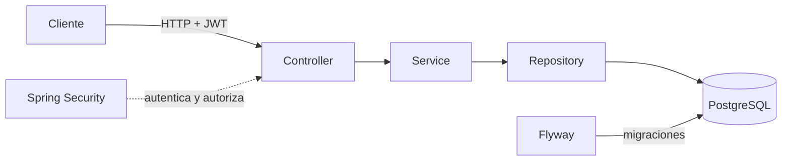

# javapp-api

API REST para la gestión de usuarios, perfiles académicos y autenticación de una aplicación educativa. Construida con Java 21 y Spring Boot sobre PostgreSQL, con el esquema administrado exclusivamente por Flyway.

[](https://openjdk.org/projects/jdk/21/)
[](https://spring.io/projects/spring-boot)
[](https://www.postgresql.org/)
[](https://flywaydb.org/)
[](https://swagger.io/)

## Descripción general

`javapp-api` resuelve la base de identidad de la aplicación:

- Registro público de estudiantes con perfil académico obligatorio.
- Login con access JWT de corta duración y refresh token opaco rotatorio.
- CRUD de usuarios con desactivación lógica y asignación de roles.
- Perfiles de estudiante consultables y editables por su propietario o un administrador.
- Autorización basada en los roles `admin`, `student` y `professor`.
- Documentación interactiva de la API con Swagger UI.

El esquema de base de datos ya contempla cursos, inscripciones, sesiones y asistencia, pero esas entidades todavía no exponen endpoints.

## Stack

| Componente | Versión / uso |
| --- | --- |
| Java | 21 (toolchain de Gradle) |
| Spring Boot | 4.1.1 |
| Spring Security | OAuth2 Resource Server, JWT HS256 y BCrypt |
| Persistencia | Spring Data JPA / Hibernate (`ddl-auto: validate`) |
| Base de datos | PostgreSQL |
| Migraciones | Flyway |
| Documentación | springdoc-openapi + Swagger UI |
| Build | Gradle Kotlin DSL, wrapper 9.8.2 |
| Formato | Spotless + google-java-format 1.36.0 |

## Requisitos

- JDK 21.
- PostgreSQL en ejecución.
- No necesitas instalar Gradle: usa el wrapper incluido.

## Inicio rápido

1. Crea una base de datos vacía. Flyway crea las tablas, pero no la base.

   ```shell
   createdb -U postgres app_db
   ```

2. Copia el archivo de ejemplo y completa tus credenciales locales.

   ```shell
   cp .env.example .env
   ```

3. Genera un secreto de al menos 32 bytes para firmar los JWT.

   ```shell
   openssl rand -hex 32
   ```

4. Inicia la aplicación.

   ```shell
   ./gradlew bootRun
   ```

La API queda disponible en `http://localhost:8080`.

## Configuración

`src/main/resources/application.yml` importa `.env` de forma opcional y lee las siguientes variables:

| Variable | Obligatoria | Valor predeterminado | Descripción |
| --- | --- | --- | --- |
| `DB_HOST` | No | `localhost` | Host de PostgreSQL |
| `DB_PORT` | No | `5432` | Puerto de PostgreSQL |
| `DB_NAME` | No | `app_db` | Nombre de la base de datos |
| `DB_USER` | Sí | — | Usuario de la base de datos |
| `DB_PASSWORD` | Sí | — | Contraseña de la base de datos |
| `JWT_SECRET` | Sí | — | Secreto HS256 de al menos 32 bytes UTF-8 |

La aplicación falla al iniciar si falta `JWT_SECRET`, si es demasiado corto o si no puede resolver las credenciales de PostgreSQL.

> [!IMPORTANT]
> `.env` está excluido de Git. No publiques credenciales ni el secreto JWT.

## Documentación de la API

Con la aplicación en marcha:

| Recurso | URL |
| --- | --- |
| Swagger UI | `http://localhost:8080/api/docs` |
| OpenAPI JSON | `http://localhost:8080/api/docs/openapi` |

Swagger UI permite explorar los endpoints, ver los esquemas de entrada y salida y probar las rutas protegidas. Usa el botón **Authorize** e introduce el access token con el esquema `bearerAuth`. La documentación es pública y no requiere autenticación.

## Autenticación y autorización

Todas las rutas usan el prefijo `/api/v1`.

- El registro público siempre crea una cuenta activa con rol `student` y exige `studentProfile`.
- El access token es un JWT HS256 de 15 minutos y se envía como `Authorization: Bearer <accessToken>`.
- El refresh token es opaco, dura 30 días, se rota en cada uso y solo se almacena su hash SHA-256.
- Las cuentas desactivadas no pueden iniciar sesión ni refrescar tokens.
- `DELETE /users/{id}` es un borrado lógico: desactiva la cuenta y revoca sus refresh tokens.

### Roles

| Rol | Alcance |
| --- | --- |
| `admin` | Gestiona usuarios, roles y perfiles de estudiante |
| `student` | Consulta y edita sus propios datos y perfil académico |
| `professor` | Rol reservado para futuras funcionalidades docentes |

## Endpoints

| Método | Ruta | Acceso | Resultado |
| --- | --- | --- | --- |
| `POST` | `/api/v1/auth/register` | Público | Crea una cuenta `student` y su perfil (`201`) |
| `POST` | `/api/v1/auth/login` | Público | Devuelve access y refresh token |
| `POST` | `/api/v1/auth/refresh` | Público con refresh token | Rota el refresh y devuelve un par nuevo |
| `POST` | `/api/v1/auth/logout` | Público con refresh token | Revoca el refresh presentado (`204`) |
| `GET` | `/api/v1/users` | `admin` | Lista usuarios paginados |
| `POST` | `/api/v1/users` | `admin` | Crea un usuario con roles existentes (`201`) |
| `GET` | `/api/v1/users/{id}` | `admin` o propietario | Consulta un usuario |
| `PUT` | `/api/v1/users/{id}` | `admin` o propietario | Actualiza datos; solo `admin` cambia roles o estado |
| `DELETE` | `/api/v1/users/{id}` | `admin` | Desactiva la cuenta y revoca sus refresh tokens (`204`) |
| `GET` | `/api/v1/users/{id}/student-profile` | `admin` o propietario `student` | Consulta el perfil académico |
| `PUT` | `/api/v1/users/{id}/student-profile` | `admin` o propietario `student` | Crea o actualiza el perfil académico |

`GET /api/v1/users` acepta los parámetros estándar de Spring Data: `page`, `size` y `sort`.

## Ejemplos

### Registro

```shell
curl -i -X POST http://localhost:8080/api/v1/auth/register \
  -H 'Content-Type: application/json' \
  -d '{
    "name": "Ana",
    "lastname": "Perez",
    "email": "ana@example.test",
    "password": "Password8",
    "studentProfile": {
      "studentCode": "S-104",
      "major": "Computer Science"
    }
  }'
```

### Login

```shell
curl -i -X POST http://localhost:8080/api/v1/auth/login \
  -H 'Content-Type: application/json' \
  -d '{"email":"ana@example.test","password":"Password8"}'
```

```json
{
  "accessToken": "<jwt>",
  "refreshToken": "<token-opaco>",
  "tokenType": "Bearer",
  "expiresIn": 900
}
```

### Renovar la sesión

```shell
curl -i -X POST http://localhost:8080/api/v1/auth/refresh \
  -H 'Content-Type: application/json' \
  -d '{"refreshToken":"<refreshToken>"}'
```

Cada renovación invalida el refresh anterior. Guarda el token de forma segura: el servidor no puede recuperarlo, solo comparar su hash.

### Consultar usuarios como administrador

```shell
curl -s 'http://localhost:8080/api/v1/users?page=0&size=20' \
  -H "Authorization: Bearer <accessToken>"
```

### Actualizar un perfil académico

```shell
curl -i -X PUT http://localhost:8080/api/v1/users/1/student-profile \
  -H 'Content-Type: application/json' \
  -H "Authorization: Bearer <accessToken>" \
  -d '{"studentCode":"S-104","major":"Software Engineering"}'
```

### Crear el primer administrador

El registro público nunca permite asignar roles privilegiados. Registra una cuenta `student` y promuévela con SQL:

```sql
INSERT INTO user_roles (user_id, role_id)
SELECT users.id, roles.id
FROM users
JOIN roles ON roles.name = 'admin'
WHERE users.email = 'admin@example.test'
ON CONFLICT (user_id, role_id) DO NOTHING;
```

Después de eso, esa cuenta puede gestionar usuarios y asignar los roles existentes.

## Reglas de negocio

- La contraseña debe tener al menos 8 caracteres y un máximo de 72 bytes UTF-8, límite de BCrypt.
- El registro público exige `name`, `lastname`, `email`, `password` y `studentProfile`.
- Un usuario con rol `student` debe tener perfil académico; un usuario sin ese rol no puede tenerlo.
- Solo se asignan roles ya existentes en el catálogo.
- El propietario puede editar sus datos, pero no sus roles ni su estado.
- Los documentos (`documentType`, `documentNumber`), el email y el `studentCode` son únicos.
- Las respuestas nunca exponen hashes de contraseñas ni de refresh tokens.

## Errores

Los errores usan un cuerpo JSON uniforme:

```json
{
  "timestamp": "2026-01-01T12:00:00Z",
  "status": 409,
  "error": "Conflict",
  "message": "Email is already registered",
  "path": "/api/v1/auth/register"
}
```

| Estado | Cuándo ocurre |
| --- | --- |
| `400` | Validación de entrada o argumento inválido |
| `401` | Credenciales incorrectas o refresh token inválido/expirado |
| `403` | Acceso a recursos de otro usuario o cambio de roles/estado sin permiso |
| `404` | Usuario, perfil o ruta inexistente |
| `409` | Email, documento o código de estudiante duplicado |
| `500` | Error no controlado |

## Base de datos y migraciones

Flyway aplica las migraciones de `src/main/resources/db/migration/` al iniciar:

- `V1__create_initial_application_schema.sql`: crea el esquema base.
- `V2__seed_initial_roles.sql`: inserta los roles `admin`, `student` y `professor` de forma idempotente.

El esquema incluye `users`, `roles`, `user_roles`, `student_profiles`, `refresh_tokens`, `courses`, `course_enrollments`, `class_sessions` y `attendance_records`, con sus claves, restricciones e índices.

> [!WARNING]
> La migración `V1` elimina todas las tablas del esquema actual, excepto `flyway_schema_history`, antes de crear el esquema de la aplicación. No la ejecutes sobre una base con datos que quieras conservar.

Hibernate usa `ddl-auto: validate`: comprueba que las entidades coincidan con el esquema, pero nunca lo crea ni lo modifica.

## Estructura del proyecto

```text
src/main/java/com/aireck/javapp/
  config/              # configuración de OpenAPI
  controller/          # endpoints REST, DTOs de error y manejo global
  dto/                 # contratos de entrada y salida
  model/               # entidades JPA y claves compuestas
  repository/          # repositorios Spring Data
  security/            # Spring Security, JWT y BCrypt
  service/             # interfaces, reglas de negocio e implementaciones
src/main/resources/
  application.yml      # datasource, JPA, Flyway, JWT y springdoc
  db/migration/        # migraciones versionadas de Flyway
src/test/java/com/aireck/javapp/
  ...                  # pruebas de controladores, DTOs, modelos, seguridad y servicios
```

Flujo de una petición:



## Comandos

| Comando | Uso |
| --- | --- |
| `./gradlew bootRun` | Ejecutar la aplicación |
| `./gradlew test` | Ejecutar la suite de pruebas |
| `./gradlew build` | Compilar y ejecutar toda la suite de pruebas |
| `./gradlew spotlessApply` | Formatear el código Java |
| `./gradlew spotlessCheck` | Verificar el formato sin modificar archivos |

## Pruebas

```shell
./gradlew test
```

La suite cubre validación de DTOs, mapeo de entidades, emisión y validación de JWT, configuración de seguridad, contrato HTTP, reglas de servicio y ciclo de vida de los refresh tokens.

## Alcance actual

Esta entrega implementa identidad, usuarios, perfiles de estudiante y autenticación. El esquema de cursos, inscripciones, sesiones y asistencia ya existe, pero todavía no expone endpoints para esas entidades. Tampoco incluye perfil de profesor ni frontend.
